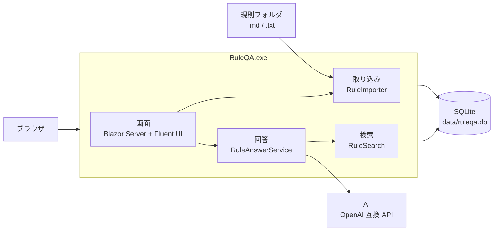

# 社内規則 Q&A（RuleQA）

就業規則・旅費規程などの社内規則を条文ごとに取り込み、社員の質問に根拠の条文を添えて答える業務アプリです。
規則に書かれていないことは「規則には記載がありません」、規則と関係のない質問は「対象外」と答えます。

- **zip を解凍して exe を起動するだけで動作**（インストール不要・.NET 不要・DB サーバー不要）
- **AI は接続設定式**：Azure OpenAI / OpenAI / Gemini から、Ollama などのローカル LLM まで、OpenAI 互換 API ならどれでも利用可能
- **AI なしでも動作**：キーワード検索で、質問に近い条文を示す
- **根拠を確かめられる回答**：AI が引用した条文 ID を、検索で渡した条文と照らし合わせてから表示
- **規則の改定に追従**：フォルダの変更を条文単位で確かめてから取り込み。旧版・参考資料（FAQ）を規程と区別
- **品質を測れる**：評価用の質問セットで検索と回答の正解率を測り、プロンプトやモデルの変更を保存前に比べられる

## 画面

| 画面 | 内容 |
|---|---|
| 質問 | 会話形式の質問。回答に根拠の条文（開くと本文・ファイル・施行日）。「役に立った／役に立たなかった」の評価とコメント |
| 規則一覧 | 規程と条文の表示・検索、取り込み時の警告（条番号の抜け・重複）。管理者は「取り込みの管理」で変更を選んで取り込む |
| 履歴 | 質問と回答の一覧。文字・状態（回答／記載なし／検索のみ／対象外）・評価で絞り込み、会話の続きから再開 |
| 設定 | AI の接続先（プリセットと接続テスト）、規則のフォルダと検索、AI への指示（プロンプト）の編集、評価 |

ログインはなく、デモのため利用者を管理者（`CurrentUser.DemoAdmin`）として扱います。管理者だけの操作には「管理者」の印を付けています。

## 構成



### 処理の流れ

1. **取り込み**：`.md` / `.txt` を「第○条」ごとに分ける（長い条は「第7条第1項」のように項で分ける）。条のない文書（FAQ など）は見出しや段落で分ける。文字コードは UTF-8 / UTF-16 / Shift_JIS を判定。条番号の抜け・重複は警告として残し、重複は「第7条(2)」として取り込む
2. **版の判定**：同じ規程名の文書が複数あれば施行日・改定日が最も新しいものを最新版とし、それ以外と「廃止」「旧版」と書かれたものは旧版にする（既定では検索の対象外）
3. **検索**：キーワード検索（BM25）と、埋め込みモデルを設定した場合はベクトル検索を行い、RRF（Reciprocal Rank Fusion）で順位を合わせる
4. **回答**：上位の条文（既定 6 件）に ID（`A1`…）を付けて AI に渡し、JSON（`answer` / `citations` / `answered` / `off_topic`）で受け取る。渡していない ID の引用は捨て、根拠が残らなければ「記載なし」として扱う
5. **記録**：質問・回答・根拠・所要時間を履歴に保存し、社員の評価（役に立った／役に立たなかった）を付ける

### AI 接続の工夫

- 構造化出力の対応が接続先ごとに違うため、`json_schema` → `json_object` → 指定なし の順に自動で切り替え
- AI への指示は、管理者が編集できる部分と、ID での引用と JSON の形式を決める固定の部分に分け、指示を書き換えても回答を読み取れなくならないようにした
- 規程どうしの食い違い、参考資料と規程の食い違い、旧版の扱いを指示で決め、サンプル規則にわざとその箇所を入れて評価している
- 会話の続きの質問（「海外の場合は？」）は、直前の会話も一緒に渡して検索と回答に使う

### 評価

`samples/questions.json`（39 問）に、質問・正解の条文 ID・種類（基本・言い換え・旧版・矛盾・記載なし・対象外など）を入れています。`data/questions.json` を置くとそちらを使います。

| 評価 | 内容 |
|---|---|
| 検索を評価（AI なし） | 正解の条文が候補に入った割合と 1 位の割合 |
| 回答を評価（AI を使う） | 根拠の一致、記載なし・対象外の質問に答えなかった割合、対象外の判定、答えられるのに答えなかった件数、平均時間 |

どちらも保存前の設定で実行し、結果は「これまでの評価」に残ります。Ollama（qwen2.5:7b）では、根拠の一致 91%（32 問）、記載なし・対象外への対応 100%（7 問）、1 問あたり約 2 秒でした。

## 使い方

### 配布用 zip から

1. `RuleQA-win-x64.zip` を解凍して `RuleQA.exe` を起動（ブラウザで http://localhost:5090 が開きます）
2. 初回起動時に `samples/rules` の架空の会社「サンプル商事」の規則を取り込みます
3. 「質問」で「国内出張の日当はいくら？」などと質問します（初期設定は AI なし）

### 接続先の例

設定画面の「AI の接続先」で「OpenAI 互換 API」を選び、プリセットで入力欄を埋めてから書き換えます。

| 接続先 | エンドポイント | モデル | API キー |
|---|---|---|---|
| Azure OpenAI | `https://<リソース名>.openai.azure.com/openai/v1` | Azure で作成した**デプロイ名** | Azure ポータルの「キーとエンドポイント」 |
| OpenAI | `https://api.openai.com/v1` | `gpt-4.1-mini` など | [OpenAI Platform](https://platform.openai.com/) で発行 |
| Gemini | `https://generativelanguage.googleapis.com/v1beta/openai` | `gemini-2.5-flash` など | [Google AI Studio](https://aistudio.google.com/) で発行 |
| Ollama（ローカル） | `http://localhost:11434/v1` | `qwen2.5:7b` など（事前に `ollama pull`） | 不要 |
| LM Studio（ローカル） | `http://localhost:1234/v1` | LM Studio で読み込んだモデル名 | 不要 |

- 埋め込みモデル（任意）は、チャットと同じ接続先の `/embeddings` を使います（Ollama なら `bge-m3` など）。未設定ならキーワード検索のみです。
- API キーは、Windows の DPAPI でユーザーごとに暗号化して保存します。
- 動作確認：Ollama（qwen2.5:7b）は実機で確認済み。その他の接続先は、送信内容（URL・認証ヘッダー・本文）を自動テストで確認しています。

## 開発

必要なもの：[.NET 10 SDK](https://dotnet.microsoft.com/)

```powershell
powershell -ExecutionPolicy Bypass -File scripts\setup-git.ps1   # 最初に 1 回（git の設定）
dotnet run --project src/RuleQA.Web       # http://localhost:5090
dotnet test                               # テスト
powershell -ExecutionPolicy Bypass -File scripts\publish.ps1   # artifacts\RuleQA-win-x64.zip を作成
```

`publish.ps1` は確認用に `RuleQA-latest\RuleQA.exe` も更新します（`data` フォルダは残します）。
あわせてテストを実行し、テスト仕様書 `docs/test-spec.md` と、結果を含む報告書 `RuleQA-latest\test-report.md` を作ります。テスト仕様書の内容は、各テストに付けた `[Spec]` 属性（区分・項目名・確認内容）から作られます。
テスト仕様書と報告書だけを作り直すときは、`dotnet run scripts/TestReport.cs -- . RuleQA-latest` を実行します。

zip には次の利用者向けの文書も入ります。

| zip 内のファイル | 元 |
|---|---|
| `README.txt` | `docs/README-distribution.txt` |
| `LICENSE.txt`（利用条件） | `docs/distribution/LICENSE.txt` |
| `THIRD-PARTY-NOTICES.txt`（外部部品のライセンス表記） | `docs/distribution` の部品一覧とライセンス本文に、NuGet パッケージ内の .NET / ASP.NET Core Runtime の表記を付けて作る |
| `社内規則Q&A（RuleQA）のご紹介.pdf`（非エンジニア向けの紹介・使い方） | `docs/portfolio/guide.html` を `scripts/build-docs.ps1` が Microsoft Edge で PDF にする |

案内 PDF だけを作り直すときは、`powershell -ExecutionPolicy Bypass -File scripts\build-docs.ps1` を実行します（`artifacts\RuleQA-guide.pdf`。zip には上の日本語の名前で入れます）。Edge がない環境では PDF を省きます。

`setup-git.ps1` は、このクローンに次の 2 つを設定します。
- `main` への直接プッシュを止める `pre-push` フック（`.githooks`）。変更はブランチを切り、PR からスカッシュマージします。
- 自動生成の `docs/test-spec.md` がマージで競合したときに、手元側を自動で残す設定。マージ後に `dotnet run scripts/TestReport.cs -- .` で作り直します。

### CI（GitHub Actions）

`.github/workflows/ci.yml` で、次を自動で行います（Windows で実行）。

| きっかけ | 内容 |
|---|---|
| `main` への push・PR | ビルドとテスト。報告書を成果物 `test-report` に保存。`docs/test-spec.md` が古いと失敗 |
| `v*` タグの push・手動実行 | 上に加えて、配布物を成果物 `RuleQA-win-x64` に保存 |

ワークフローで使う公式部品（`actions/checkout` など）は、Dependabot（`.github/dependabot.yml`）が新しい安定版を確認し、版上げの PR を作ります。

| フォルダ | 内容 |
|---|---|
| `src/RuleQA.Core` | 取り込み・検索・回答・評価・DB のロジック（画面に依存しない） |
| `src/RuleQA.Web` | Blazor Server の画面と起動処理 |
| `tests/RuleQA.Tests` | xUnit のテスト（AI 接続は偽の HTTP サーバーで検証） |
| `samples/rules` | デモ用の架空の規則（旧版・規程どうしの食い違い・参考資料の FAQ を含む） |
| `samples/questions.json` | 評価用の質問 39 問と正解の条文 |
| `docs/requirements.md` | 要件と開発の計画 |
| `docs/distribution` | 配布物に入れる利用条件・外部部品のライセンス表記の元 |
| `docs/portfolio` | 案内 PDF の元（HTML と画面写真） |
| `scripts/publish.ps1` | 配布用 zip の作成 |
| `scripts/build-docs.ps1` | 案内 PDF の作成 |
| `scripts/TestReport.cs` | テスト仕様書・テスト報告書の作成 |
| `scripts/setup-git.ps1` | git の初期設定（`pre-push` フックと、生成ファイルのマージ設定） |
| `.github/workflows` | CI の設定 |

## 技術スタック

C# / .NET 10、ASP.NET Core Blazor Server、Fluent UI Blazor、Entity Framework Core + SQLite、xUnit
